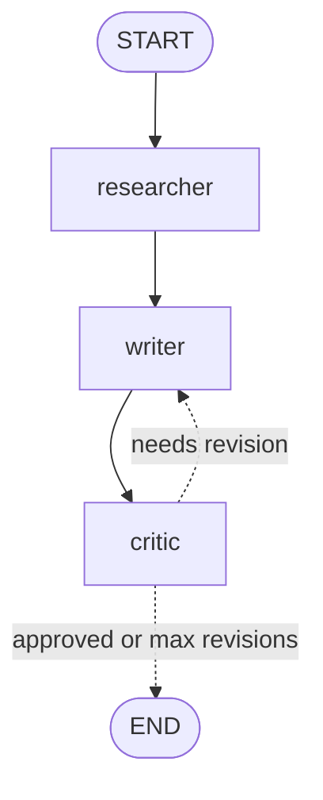

# Multi-Agent Research Writer

A research → write → critique pipeline built with **LangGraph** and the **OpenAI API**. Three specialized agents collaborate on a shared state: one researches a topic with live web search, one drafts an article from those notes, and one reviews the draft and sends it back for revision until it passes or a revision limit is reached.

## Architecture



| Agent | Role | Tool calling |
|---|---|---|
| **Researcher** | Gathers facts, figures, viewpoints and open questions as sourced bullet notes | Yes. OpenAI's built-in web search (server-side, via the Responses API) |
| **Writer** | Turns the notes into a ~500-word Markdown article; on revision passes it receives its previous draft plus the critic's feedback | No |
| **Critic** | Scores the draft against the research notes and returns a validated `Critique` (approved, score 1–10, feedback) | Structured output, validated by Pydantic |

A plain-Python router after the critic decides whether to loop back to the writer or end. The stop rule lives in code, not in a prompt, so the loop always terminates.

## Key design choices

**Shared typed state.** Every node reads from and writes to one `State` (a `TypedDict`). Nodes return only the keys they change, and LangGraph merges them. The `log` field uses a reducer (`Annotated[list[str], operator.add]`), so each agent's progress lines are appended rather than overwritten.

**Structured critique.** The critic returns a Pydantic `Critique` model instead of free text. Field constraints (`score` must be 1–10) reject malformed model output before it can reach the router.

**Server-side tools.** Web search runs inside a single API call on OpenAI's side, so the graph has no client-side tool-execution loop. `bind_tools` returns a new model object, so only the researcher can search.

**Separation of concerns.** Each agent lives in its own module and only imports shared config, state and utilities, so agents can be tested, swapped or extended independently.

## Project structure

```
multi-agent/
├── config.py          # model and settings, loaded from .env
├── state.py           # State and Critique schemas
├── utils.py           # text_of: normalizes model responses to plain text
├── agents/
│   ├── researcher.py  # web search + sourced notes
│   ├── writer.py      # first draft and revision modes
│   └── critic.py      # structured scoring and feedback
├── graph.py           # router + graph wiring
├── main.py            # entry point with live progress streaming
└── requirements.txt
```

## Setup

```bash
git clone https://github.com/tanmaydebbuger30/multi-agent-research-writer.git
cd multi-agent-research-writer

python -m venv .venv
source .venv/bin/activate
python -m pip install -r requirements.txt

cp .env.example .env   # then add your OpenAI API key
```

## Usage

```bash
python main.py "AI agents in healthcare 2026"
```

Progress streams as each agent finishes, then the final article prints and is saved to `output.md` along with the research notes it was built from.

```
  -> researcher: notes gathered
  -> writer: first draft
  -> critic: 7/10, needs revision
  -> writer: revision 1
  -> critic: 7/10, needs revision
  -> writer: revision 2
  -> critic: 7/10, needs revision

Final score: 7/10 after 2 revision(s)
```

### Configuration (`.env`)

| Variable | Default | Purpose |
|---|---|---|
| `OPENAI_API_KEY` | required | Your OpenAI key |
| `OPENAI_MODEL` | `gpt-4o` | Model used by all three agents |
| `MAX_REVISIONS` | `2` | Cap on writer–critic loops |
| `USE_WEB_SEARCH` | `1` | Set to `0` to research from model knowledge only |

## Lessons from building it

**Prompts are contracts between agents.** An early version of the critic asked for statistics and topics that weren't in the research notes, while the writer was told to use only the notes. The writer couldn't satisfy the feedback, so it reshuffled the same content each round. Restricting the critic to feedback achievable from the notes alone removed the contradiction.

**A working loop is not a converging loop.** In the sample run above, the score stayed at 7/10 across all revisions. Reading the output showed why: the writer kept turning projections in the notes into stated facts and kept reintroducing hype words. Fixes included instructing the writer to preserve each claim's certainty exactly and to change only what the feedback targets, plus surfacing the critic's feedback in the logs so failures can be diagnosed instead of guessed at.

**LLM judges need anchors.** Without a concrete rubric, a "demanding editor" model tends to settle on a middle score and find something new to criticize every pass.

## Roadmap

- Fixed scoring rubric and `temperature=0` for the critic, for more consistent judgments
- Let the critic route back to the **researcher** when information is missing, not just to the writer
- Parallel researchers covering different angles, merged before writing
- Human-in-the-loop approval step using LangGraph interrupts
- Checkpointing so long runs can resume
- Source-quality filtering in the researcher prompt
